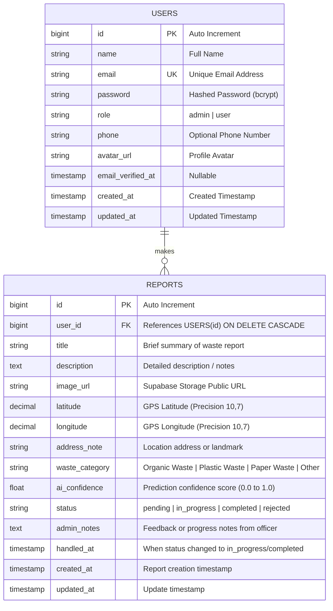

# Database Schema & Entity Relationship Diagram (ERD)
## Smart Waste Management System

### 1. PostgreSQL Supabase Architecture Overview
Database menggunakan PostgreSQL yang dihosting pada platform Supabase.
Laporan sampah (*Waste Reports*) terhubung dengan data pelapor (*Users*), menyimpan koordinat GPS, URL foto dari Supabase Storage, hasil deteksi Machine Learning, serta status penanganan.

---

### 2. Entity Relationship Diagram (Mermaid)

---

### 3. Data Dictionary

#### A. Table: `users`
| Column | Type | Nullable | Default | Description |
|---|---|---|---|---|
| `id` | `BIGINT` | NO | `AUTO_INCREMENT` | Primary key |
| `name` | `VARCHAR(255)` | NO | - | Nama lengkap pengguna |
| `email` | `VARCHAR(255)` | NO | - | Alamat email unik untuk login |
| `password` | `VARCHAR(255)` | NO | - | Hash sandi bcrypt |
| `role` | `VARCHAR(50)` | NO | `'user'` | Role akun (`admin`, `user`) |
| `phone` | `VARCHAR(50)` | YES | `NULL` | Nomor kontak/WhatsApp |
| `avatar_url` | `TEXT` | YES | `NULL` | URL foto profil |
| `created_at` | `TIMESTAMP` | YES | `NOW()` | Waktu registrasi |
| `updated_at` | `TIMESTAMP` | YES | `NOW()` | Waktu update data |

#### B. Table: `reports`
| Column | Type | Nullable | Default | Description |
|---|---|---|---|---|
| `id` | `BIGINT` | NO | `AUTO_INCREMENT` | Primary key |
| `user_id` | `BIGINT` | NO | - | Foreign key ke `users(id)` |
| `title` | `VARCHAR(255)` | NO | - | Judul laporan |
| `description` | `TEXT` | YES | `NULL` | Deskripsi sampah/kondisi |
| `image_url` | `TEXT` | NO | - | Public URL file bukti di Supabase Storage |
| `latitude` | `DECIMAL(10,7)`| YES | `NULL` | Koordinat lintang GPS |
| `longitude`| `DECIMAL(10,7)`| YES | `NULL` | Koordinat bujur GPS |
| `address_note` | `VARCHAR(255)` | YES | `NULL` | Catatan patokan/alamat |
| `waste_category` | `VARCHAR(100)` | NO | `'Other'` | Kategori sampah hasil AI |
| `ai_confidence` | `DOUBLE PRECISION` | YES | `0.0` | Nilai keyakinan klasifikasi AI (0 - 1) |
| `status` | `VARCHAR(50)` | NO | `'pending'` | `pending`, `in_progress`, `completed`, `rejected` |
| `admin_notes` | `TEXT` | YES | `NULL` | Catatan penanganan dari admin/petugas |
| `handled_at` | `TIMESTAMP` | YES | `NULL` | Waktu mulai/selesai ditangani |
| `created_at` | `TIMESTAMP` | YES | `NOW()` | Waktu pembuatan laporan |
| `updated_at` | `TIMESTAMP` | YES | `NOW()` | Waktu pembaruan data |

---

### 4. Supabase Storage Specification
* **Bucket Name**: `waste-reports`
* **Public Access**: `true` (memungkinkan web & mobile menampilkan gambar bukti secara langsung via HTTP GET).
* **Allowed MIME Types**: `image/jpeg`, `image/png`, `image/webp`.
* **Path Convention**: `reports/{user_id}/{timestamp}_{filename}`.

